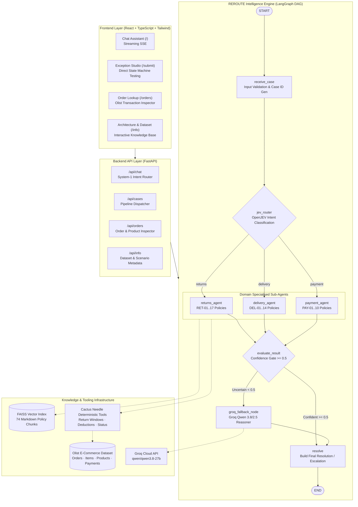

# Retail Flow (REROUTE) — System Architecture & Design

> **High-Reliability Autonomous Retail Exception Routing and Resolution Engine**  
> A production-grade architecture combining typed semantic routing, deterministic state machines, policy vector retrieval (RAG), programmatic rule execution, and LLM fallback reasoning.

---

## 1. Architectural Philosophy

Traditional AI customer support systems either:
1. **Rely entirely on LLM generation**, leading to hallucinations, unpredictable financial decisions (e.g., unauthorized refunds), and non-deterministic behavior.
2. **Rely entirely on static decision trees**, leading to brittle user experiences, failure to handle linguistic nuance, and poor flexibility.

**Retail Flow (REROUTE)** employs a **Deterministic Core with LLM Fallback (Dual-Gate Architecture)**:
- **FastAPI** provides a modern, asynchronous REST and Server-Sent Events (SSE) API.
- **OpenJEV / System-1 Classifier** routes incoming customer messages to the appropriate domain agent with sub-millisecond latency.
- **LangGraph** orchestrates the end-to-end exception resolution lifecycle as a compiled state machine (`CaseState`).
- **Policy RAG (FAISS + MiniLM)** retrieves exact corporate policy clauses from markdown manuals to ground every decision.
- **Cactus Needle Deterministic Tools** execute mathematical and temporal business logic (refund calculations, return window comparisons, duplicate charge audits).
- **Groq LLM (Qwen 3.8 / 2.5)** is invoked **only** when routing or agent confidence falls below threshold (&lt; 0.5) or when sentiment is ambiguous.
- **Automated Human Escalation Gate** prevents high-risk actions (e.g., refunds &gt; R$ 500 or missing delivery disputes outside window) from resolving without human agent sign-off.

---

## 2. End-to-End System Diagram

---

## 3. LangGraph State Schema (`CaseState`)

The graph lifecycle maintains a strictly typed state dictionary (`CaseState` extending `TypedDict(total=False)`):

| State Field | Type | Description |
| :--- | :--- | :--- |
| `case_id` | `str` | Unique case identifier (`CASE-XXXXXXXX`). |
| `order_id` | `str` | 32-character Olist hexadecimal order identifier. |
| `customer_message` | `str` | Raw customer complaint or query text. |
| `route` | `str` | Intent classification: `"returns"`, `"delivery"`, or `"payment"`. |
| `routing_confidence` | `float` | Router confidence score (0.0 – 1.0). |
| `routing_backend` | `str` | Router backend utilized (`"mock"` / `"openjev"` / `"groq"`). |
| `use_groq_fallback` | `bool` | Flag indicating whether router required Groq classification. |
| `retrieved_policies` | `list[dict]` | Relevant policy chunks retrieved from FAISS vector index. |
| `tool_results` | `dict` | Deterministic outputs from Cactus Needle tools. |
| `agent_resolution` | `str` | Domain agent resolution (`approved`, `denied`, `escalated`, etc.). |
| `agent_resolution_detail`| `str` | Human-readable explanation of the agent decision. |
| `agent_confidence` | `float` | Agent confidence score based on policy and data matching. |
| `refund_amount` | `Optional[float]` | Calculated refund value in BRL, accounting for deductions and freight. |
| `escalate` | `bool` | Whether human supervisor escalation is required. |
| `escalate_reason` | `Optional[str]` | Regulatory or policy justification for escalation. |
| `groq_used` | `bool` | True if Groq LLM fallback was invoked at any stage. |
| `groq_result` | `Optional[dict]` | Structured recommendation and confidence returned by Groq. |
| `errors` | `list[str]` | Input validation errors (missing order ID, invalid format, etc.). |

---

## 4. Subsystem Deep Dive

### 4.1 System-1 Routing Layer (`src/routing/jev_router.py`)
- **First-line classification**: Dispatches customer complaints into three operational tracks:
  - **Returns**: Damaged goods, wrong items, missing items, general returns.
  - **Delivery**: Delayed shipments, stuck in transit, marked delivered but missing.
  - **Payment**: Duplicate charges, payment status checks, cancelled order refunds.
- **Fallback Trigger**: If the top intent confidence falls below `ROUTING_CONFIDENCE_THRESHOLD` (default: 0.60), the router initiates a fast classification call to Groq before graph branch selection.

### 4.2 Semantic Policy RAG (`src/rag/policy_retriever.py`)
- Four corporate policy markdown manuals:
  - `returns.md` (Clauses RET-01 to RET-17)
  - `delivery.md` (Clauses DEL-01 to DEL-14)
  - `payments.md` (Clauses PAY-01 to PAY-10)
  - `refunds.md` (Clauses REF-01 to REF-16)
- Split into 74 semantic chunks and embedded using `sentence-transformers/all-MiniLM-L6-v2`.
- Indexed using `faiss-cpu` (IndexFlatIP with normalized vectors for cosine similarity).
- Cached to disk in `backend/data/policy_index/` for sub-millisecond retrieval on subsequent boots.

### 4.3 Deterministic Tool Execution (`src/tools/`)
All financial, temporal, and status decisions are evaluated using deterministic logic:
1. `return_windows.py`:
   - Checks delivery timestamp against return windows:
     - Standard Return: 30 days (`RET-02`)
     - Damaged Item: 7 days (`RET-09`)
     - Incorrect / Wrong Item: 14 days (`RET-11`)
     - Missing Item: 14 days (`RET-12`)
   - Calculates item refund with 20% deduction for missing accessories (`REF-06`).
2. `delivery_checks.py`:
   - Compares estimated delivery date (EDD) against actual carrier delivery timestamp.
   - Detects early delivery, minor delay (1–3 days), major delay, or stuck in transit (&gt; 5 days).
3. `payment_checks.py`:
   - Checks total payment records per order.
   - Identifies duplicate charges on the same payment type (`PAY-06`).
   - Verifies installment counts and reconciliation amounts.

### 4.4 Dual-Gate Groq LLM Fallback (`src/llm/groq_fallback.py`)
- Invoked **only** when:
  1. Router confidence &lt; 0.6.
  2. Agent confidence &lt; 0.5.
  3. The customer query is unstructured or emotionally complex.
- Employs `qwen/qwen3.8-27b` via Groq's high-speed LPU inference engine.
- Structured output schema:
  - `interpretation`: Brief plain-English summary of the customer complaint.
  - `recommended_action`: One of `approve_return`, `approve_refund`, `deny_return`, `inform_customer`, `investigate`, `escalate_to_human`.
  - `confidence`: Calibrated confidence score (0.0 – 1.0).
  - `needs_human`: Boolean flag enforcing human oversight.

---

## 5. Security & Risk Controls

1. **Deterministic Financial Bounds**: The LLM is never given direct authority to approve arbitrary refund amounts. Refund amounts are computed strictly by deterministic tool logic (`refund_amount`).
2. **High-Value Escalation Threshold**: Any return or refund where the order value exceeds R$ 500 (`ESCALATION_REFUND_THRESHOLD`) is automatically flagged for human escalation (`escalate = True`).
3. **Data Protection**: Only public order identifiers and transactional status are processed. No customer PII or raw payment credentials are leaked into prompts.
