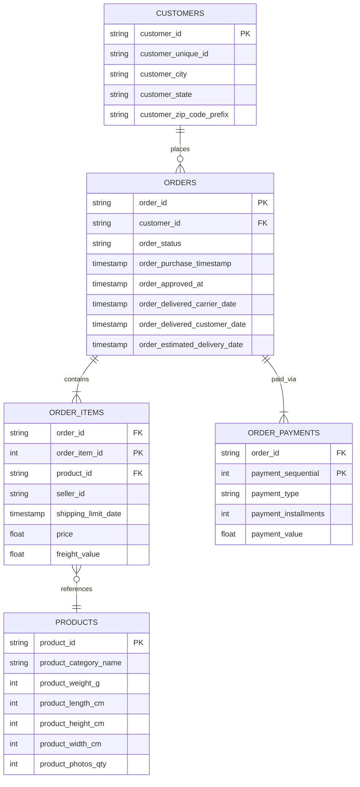

# Olist Dataset Reference & Testing Scenarios Catalog

> Complete guide to the **Brazilian E-Commerce Public Dataset by Olist** and the **15 pre-built benchmark test scenarios** for testing and validating Retail Flow.

---

## 1. The Olist Brazilian E-Commerce Dataset

Retail Flow is built on the real-world [Olist Brazilian E-Commerce Dataset](https://www.kaggle.com/datasets/olistbr/brazilian-ecommerce), published on Kaggle.

### 1.1 Dataset Statistics & Scope
- **Timeframe**: October 2016 to October 2018.
- **Geographic Coverage**: Brazil (all 27 states, from São Paulo to Acre).
- **Total Orders**: 99,441 transactions.
- **Total Order Line Items**: 112,650 items.
- **Total Unique Products**: 32,951 distinct products across 73 categories.
- **Total Payment Records**: 103,886 payment transactions.
- **Total Customers**: 99,441 customer accounts.

### 1.2 Table Relationships



---

## 2. Benchmark Testing Scenarios Catalog

Here are the 15 pre-built test cases included in `backend/examples/cases.json`, featuring verified Order IDs, Product IDs, and expected outcomes:

| Case ID | Scenario | Order ID | Product ID & Category | Price | Expected Route | Rule Citation | Expected Outcome |
| :--- | :--- | :--- | :--- | :--- | :--- | :--- | :--- |
| **CASE-001** | Damaged Item | `e481f51cbdc54678b7cc49136f2d6af7` | `87285b34884572647811a353c7ac498a`<br>*(utilidades_domesticas)* | R$ 29.99 | `returns` | RET-09 / RET-10 | Evaluates 7-day damage report window against delivery date. |
| **CASE-002** | Standard Return | `53cdb2fc8bc7dce0b6741e2150273451` | `595fac2a385ac33a80bd5114aec74eb8`<br>*(perfumaria)* | R$ 118.70 | `returns` | RET-02 / RET-03 | Denied: standard 30-day return window long expired. |
| **CASE-003** | Wrong Item | `47770eb9100c2d0c44946d9cf07ec65d` | `aa4383b373c6aca5d8797843e5594415`<br>*(automotivo)* | R$ 159.90 | `returns` | RET-11 | Evaluates 14-day incorrect item claim window. |
| **CASE-004** | Minor Delay | `949d5b44dbf5de918fe9c16f97b45f8a` | `d0b61bfb1de832b15ba9d266ca96e5b0`<br>*(pet_shop)* | R$ 45.00 | `delivery` | DEL-07 | Compares current date with EDD (2017-12-15). |
| **CASE-005** | Early Delivery | `ad21c59c0840e6cb83a9ceb5573f8159` | `65266b2da20d04dbe00c5c2d3bb7859e`<br>*(papelaria)* | R$ 19.90 | `delivery` | DEL-03 / DEL-04 | Detects package was delivered 10 days before EDD. |
| **CASE-006** | Delivered but Missing | `76c6e866289321a7c93b82b54852dc33` | `ac1789e492dcd698c5c10b97a671243a`<br>*(moveis_decoracao)* | R$ 19.90 | `delivery` | DEL-12 | Delivery marked on 2017-02-02; outside 7-day window. |
| **CASE-007** | Stuck in Transit | `ee64d42b8cf066f35eac1cf57de1aa85` | `c50ca07e9e4db9ea5011f06802c0aea0`<br>*(beleza_saude)* | R$ 14.49 | `delivery` | DEL-11 | Order status is `"shipped"`; triggers carrier inquiry. |
| **CASE-008** | Duplicate Payment | `0016dfedd97fc2950e388d2971d718c7` | `4089861a1bd4685da70bddd6b4f974f1`<br>*(ferramentas_jardim)* | R$ 49.75 | `payment` | PAY-06 | Detects 2 credit card payments; confirms duplicate. |
| **CASE-009** | Payment Query | `002f19a65a2ddd70a090297872e6d64e` | `9eae06d51aaa383b2bed5547a19d581c`<br>*(cama_mesa_banho)* | R$ 53.98 | `payment` | PAY-03 | Returns verified payment breakdown and installments. |
| **CASE-010** | Cancelled Order Refund | `1b9ecfe83cdc259250e1a8aca174f0ad` | `ad673c1cd02b966e931f9db4fdc34791`<br>*(informatica_acessorios)* | R$ 25.00 | `payment` | PAY-08 / REF-08 | Order status is `"canceled"`; approves full refund. |
| **CASE-011** | High-Value Damage | `000576fe39319847cbb9d288c5617fa6` | `557d850972a7d6f792fd18ae1400d9b6`<br>*(ferramentas_jardim)* | R$ 810.00 | `returns` | RET-17 / REF-15 | Value &gt; R$ 500 mandates human agent escalation. |
| **CASE-012** | Missing Item | `6514b8ad8028c9f2cc2374ded245783f` | `4520766ec412348b8d4caa5e8a18c464`<br>*(automotivo)* | R$ 59.99 | `returns` | RET-12 | Checks 14-day missing item report window. |
| **CASE-013** | Ambiguous Return | `a4591c265e18cb1dcee52889e2d8acc3` | `060cb19345d90064d1015407193c233d`<br>*(automotivo)* | R$ 147.90 | `returns` | RET-02 | Natural language keyword / semantic intent routing. |
| **CASE-014** | Vague Billing Query | `714fb133a6730ab81fa1d3c1b2007291` | `a0b7d5a992ccda646f2d34e418fff5a0`<br>*(moveis_decoracao)* | R$ 69.90 | `payment` | PAY-01 / LLM | Routes to payment; Groq fallback provides narrative. |
| **CASE-015** | Invalid Order ID | `INVALID-ORDER-99999` | `N/A` | R$ 0.00 | `returns` | System Validation | Graceful error handling; escalates with data error. |

---

## 3. How Anyone Can Test Anything

### 3.1 Via the Web Interface
1. **Interactive Scenarios**: Navigate to `http://localhost:5173/info` and click **Test Scenarios & Cases**. Click **Test in Chat** or **Test in Studio** on any card to automatically pre-fill the scenario.
2. **Chat Assistant**: Visit `http://localhost:5173/`, enter any 32-character Order ID (or click a quick suggestion pill), type your complaint, and watch the streaming response.
3. **Order Lookup**: Visit `http://localhost:5173/orders` to look up any of the 99,441 orders in the Olist database.

### 3.2 Via the REST API
Submit any custom exception case directly using `curl` or HTTP client:

```bash
curl -X POST http://localhost:8001/api/cases \
  -H "Content-Type: application/json" \
  -d '{
    "order_id": "000576fe39319847cbb9d288c5617fa6",
    "customer_message": "My order arrived damaged. I want a refund."
  }'
```

Look up product metadata:
```bash
curl http://localhost:8001/api/orders/products/557d850972a7d6f792fd18ae1400d9b6
```

Fetch system metrics and all 15 scenarios:
```bash
curl http://localhost:8001/api/info
```

### 3.3 Via the CLI Engine
Run benchmark cases directly in the terminal from `backend/`:

```bash
cd backend
python main.py --case CASE-001
python main.py --all
```
